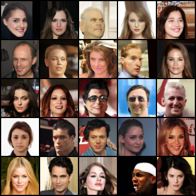
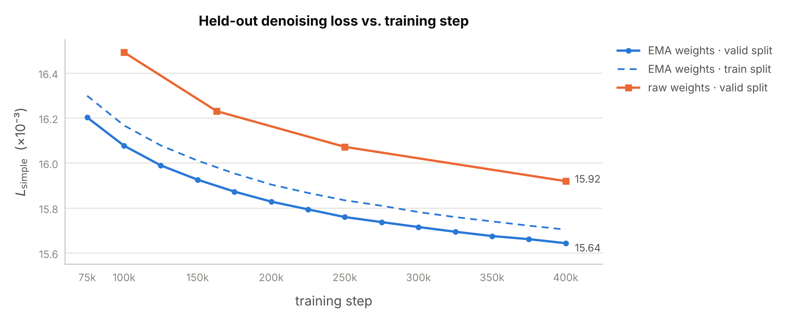
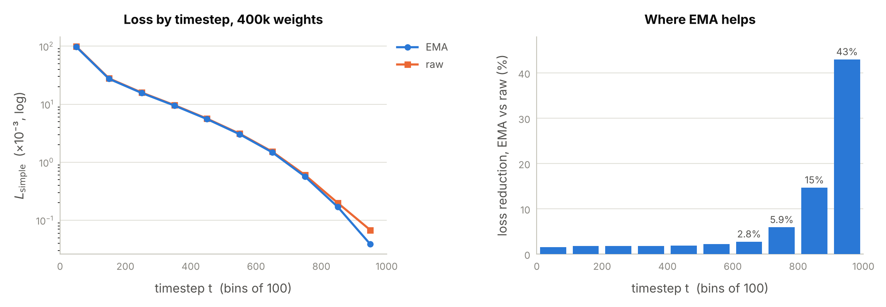

# DDPM from Scratch — CelebA 64×64

A discrete-time denoising diffusion probabilistic model (Ho et al., 2020), implemented from first
principles in PyTorch and trained unconditionally on CelebA faces at 64×64: $\epsilon$-prediction,
closed-form forward process, analytic reverse posterior, and fixed posterior variance.


<p align="center">
  
  <br>
  <sub>Uncurated samples · EMA weights at 400k steps · 1,000-step ancestral sampling · seed 0</sub>
</p>

| Metric | Value |
|:---|:---|
| **FID@10k**, EMA weights, 400k steps | **7.43** (8.23 at 200k) |
| Held-out denoising loss, EMA, 400k steps | 15.64 × 10⁻³ on valid vs. 15.70 × 10⁻³ on train: no generalization gap |
| EMA vs. raw weights at 400k | −1.7 % loss overall, −43 % at the noisiest timesteps |
| Model | 35.7M-parameter U-Net, $T = 1000$, linear $\beta$ schedule |
| Training | 400k steps × batch 24 = 9.6M images (≈ 59 epochs) |

<p align="center">
  <a href="#results">Results</a> ·
  <a href="#method">Method</a> ·
  <a href="#architecture">Architecture</a> ·
  <a href="#training">Training</a> ·
  <a href="#reproducing">Reproducing</a> ·
  <a href="#limitations">Limitations</a> ·
  <a href="#candidate-next-steps">Next steps</a>
</p>

## Motivation

I built this DDPM from scratch after studying diffusion models in Lectures 22 and 23 of CMU’s 11-785 Deep Learning series. Key components of DDPM are a training objective shared with variational autoencoders, attention blocks like those in my previous transformer implementation, and the upsampling and downsampling operations in the U-Net, which I’ve worked with in CNNs. I was particularly interested in DDPM because I’ve seen how impressive Stable Diffusion models are, and DDPM is an important stepping stone to understanding how they work.

I chose CelebA because it’s small and popular, and face quality is easy to judge by eye. Conditional generation with DDIM sampling would be a great next step, and this project let me get something small working before moving to larger datasets. Training was lengthy and intensive, taking around 20 hours split between my M5 MacBook and a 5070 Ti. I plan to use my experience with this project to move towards using diffusion for new, more interesting tasks like action policies for robotics. 

---

## Results

### Evaluation protocol

All numbers come from `eval.py` and are stored in `runs/ddpm_150k/eval/results.json`.

- **Checkpoints.** EMA weights every 25k steps from 75k to 400k, and raw (live) weights at 100k,
  163k, 250k and 400k.
- **Denoising loss.** $L_\text{simple}$ on 5,000 evenly spaced images from each of the valid and
  train splits, with dropout off. Batch $i$ draws its $(t, \epsilon)$ from a generator seeded with
  $i$, so every checkpoint is scored on identical $(x_0, t, \epsilon)$ triples and differences
  between checkpoints are paired comparisons. Reported overall and in ten bins of 100 timesteps.
- **FID.** 10,000 samples per checkpoint from 1,000-step ancestral sampling. Chunk $i$ of 250
  samples uses seed $i$ for every checkpoint, so checkpoints are compared on the same sampling
  noise. Features are 2048-d pool features from torch-fidelity's `inception-v3-compat` extractor
  (the TensorFlow FID weights and resize). The reference set is all 162,770 training images with
  the same crop and resize used in training. The matrix square root is computed through symmetric
  eigendecompositions rather than `scipy.linalg.sqrtm`.
- The test split was not used.

### FID

| Checkpoint | FID@10k | Change |
|:---|---:|---:|
| EMA, 200k steps | 8.23 | |
| EMA, 400k steps | **7.43** | −0.80 (−9.7 %) |

FID estimated from $N$ samples is biased upward, with a bias that shrinks roughly linearly in
$1/N$ (Chong & Forsyth, 2020). FID@10k therefore reads higher than the FID@50k figures usually
published, and together with differences in crop and reference set, these numbers are not
directly comparable to published CelebA 64×64 results. The two checkpoints share $N$, the
reference statistics and the sampling noise, so the 200k → 400k improvement is the fairest comparison available.
Each is a single draw with no confidence interval.

### Denoising loss over training

<p align="center">
  <picture>
    <source media="(prefers-color-scheme: dark)" srcset="assets/loss_vs_step_dark.png">
    
  </picture>
</p>

**Still improving, with diminishing returns.** The valid loss falls at every 25k checkpoint. The
improvement per 100k steps shrinks from 1.55 % (100k → 200k) to 0.71 % (200k → 300k) to 0.46 %
(300k → 400k). Over 200k → 400k the loss improved 1.17 % while FID improved 9.7 %; the
per-timestep breakdown below shows why the aggregate loss understates the change.

**EMA is worth more than doubling the training steps.** EMA weights at 150k (15.93 × 10⁻³)
match raw weights at 400k (15.92 × 10⁻³). At 400k, EMA is 1.7% below raw.

**No generalization gap after ≈ 59 epochs.** Valid loss sits slightly *below* train loss
(−0.06 × 10⁻³ at 400k). Per-bin differences change sign, so the gap is image-sampling noise 
rather than memorization.

<details>
<summary><b>All checkpoints</b></summary>
<br>

Losses are $L_\text{simple} \times 10^{3}$.

| Weights | Step | Valid | Train | Valid − train | FID@10k |
|:---|---:|---:|---:|---:|---:|
| EMA | 75k | 16.203 | 16.299 | −0.096 | |
| EMA | 100k | 16.077 | 16.168 | −0.090 | |
| EMA | 125k | 15.990 | 16.078 | −0.089 | |
| EMA | 150k | 15.926 | 16.011 | −0.085 | |
| EMA | 175k | 15.873 | 15.954 | −0.081 | |
| EMA | 200k | 15.829 | 15.904 | −0.076 | 8.23 |
| EMA | 225k | 15.794 | 15.867 | −0.073 | |
| EMA | 250k | 15.760 | 15.834 | −0.074 | |
| EMA | 275k | 15.738 | 15.810 | −0.073 | |
| EMA | 300k | 15.716 | 15.782 | −0.066 | |
| EMA | 325k | 15.695 | 15.760 | −0.065 | |
| EMA | 350k | 15.676 | 15.741 | −0.065 | |
| EMA | 375k | 15.662 | 15.722 | −0.060 | |
| EMA | 400k | **15.644** | 15.704 | −0.060 | **7.43** |
| Raw | 100k | 16.493 | 16.591 | −0.099 | |
| Raw | 163k | 16.231 | 16.321 | −0.090 | |
| Raw | 250k | 16.072 | 16.154 | −0.082 | |
| Raw | 400k | 15.920 | 15.986 | −0.067 | |

</details>

### Loss by timestep

<p align="center">
  <picture>
    <source media="(prefers-color-scheme: dark)" srcset="assets/loss_by_t_dark.png">
    
  </picture>
</p>

Valid split; losses are $L_\text{simple} \times 10^{3}$; the SNR column gives its value at the
first and last step of each bin.

| $t$ | $\mathrm{SNR}(t)$ | EMA 400k | Raw 400k | EMA vs. raw | EMA 200k → 400k |
|:---|:---|---:|---:|---:|---:|
| 1–100 | 1.0 × 10⁴ → 8.7 | 97.0 | 98.6 | −1.6 % | −1.1 % |
| 101–200 | 8.5 → 1.9 | 27.4 | 27.9 | −1.8 % | −1.4 % |
| 201–300 | 1.9 → 0.66 | 15.6 | 15.9 | −1.8 % | −1.2 % |
| 301–400 | 0.65 → 0.24 | 9.50 | 9.67 | −1.8 % | −0.9 % |
| 401–500 | 0.24 → 0.085 | 5.54 | 5.65 | −1.9 % | −1.0 % |
| 501–600 | 0.084 → 0.027 | 3.04 | 3.11 | −2.2 % | −1.0 % |
| 601–700 | 0.026 → 0.0070 | 1.48 | 1.52 | −2.8 % | −0.9 % |
| 701–800 | 0.0069 → 0.0015 | 0.567 | 0.602 | −5.9 % | −1.1 % |
| 801–900 | 0.0015 → 2.8 × 10⁻⁴ | 0.170 | 0.200 | −14.7 % | −2.3 % |
| 901–1000 | 2.7 × 10⁻⁴ → 4.0 × 10⁻⁵ | 0.0386 | 0.0678 | **−43.0 %** | **−10.8 %** |

**The $\epsilon$-loss is not on a common scale across $t$.** Inverting the forward marginal for
both the true and the predicted noise gives

$$
\hat{x}_0 - x_0 = -\sqrt{\frac{1-\bar\alpha_t}{\bar\alpha_t}}\left(\epsilon_\theta(x_t, t) - \epsilon\right)
\quad\Longrightarrow\quad
\left\lVert \hat{x}_0 - x_0 \right\rVert^2 = \frac{\left\lVert \epsilon_\theta(x_t, t) - \epsilon \right\rVert^2}{\mathrm{SNR}(t)},
\qquad
\mathrm{SNR}(t) = \frac{\bar\alpha_t}{1-\bar\alpha_t}
$$

$\mathrm{SNR}(t)$ falls from $10^4$ to $4 \times 10^{-5}$ over the schedule, so most of the
2,500× spread in $\epsilon$-loss across bins is the change in SNR, not a change in difficulty.

**The aggregate loss mostly measures low-noise denoising.** With $t$ drawn uniformly, the first
100 steps contribute about 60 % of $L_\text{simple}$ and the first 200 about 78 %. The 43 %
improvement from EMA in the last bin moves the aggregate by about 0.02 %.

**Both EMA and longer training mainly improve the high-noise steps.** EMA's gain over raw weights
is about 2 % for $t \le 600$ and 43 % for $t > 900$; the extra 200k steps gave about 1 % for most
bins and 10.8 % for $t > 900$. 

---

## Method

### Forward process

A fixed Markov chain adds Gaussian noise over $T$ steps according to a variance schedule
$\beta_1, \dots, \beta_T$:

$$
q(x_t \mid x_{t-1}) = \mathcal{N}\left(x_t;\ \sqrt{1-\beta_t}\ x_{t-1},\ \beta_t \mathbf{I}\right)
$$

With $\alpha_t = 1 - \beta_t$ and $\bar\alpha_t = \prod_{s=1}^{t} \alpha_s$, the chain has a
closed form at any $t$, so a training example needs no sequential simulation:

$$
q(x_t \mid x_0) = \mathcal{N}\left(x_t;\ \sqrt{\bar\alpha_t}\ x_0,\ (1-\bar\alpha_t)\mathbf{I}\right)
\quad\Longleftrightarrow\quad
x_t = \sqrt{\bar\alpha_t}\ x_0 + \sqrt{1-\bar\alpha_t}\ \epsilon, \qquad \epsilon \sim \mathcal{N}(0, \mathbf{I})
$$

### Reverse posterior

Conditioned on $x_0$, the reverse step is Gaussian in closed form:

$$
q(x_{t-1} \mid x_t, x_0) = \mathcal{N}\left(x_{t-1};\ \tilde\mu_t(x_t, x_0),\ \tilde\beta_t \mathbf{I}\right)
$$

$$
\tilde\mu_t(x_t, x_0) = \frac{\sqrt{\bar\alpha_{t-1}}\ \beta_t}{1-\bar\alpha_t}\ x_0 + \frac{\sqrt{\alpha_t}\ (1-\bar\alpha_{t-1})}{1-\bar\alpha_t}\ x_t,
\qquad
\tilde\beta_t = \frac{1-\bar\alpha_{t-1}}{1-\bar\alpha_t}\ \beta_t
$$

With the convention $\bar\alpha_0 = 1$, this gives $\tilde\beta_1 = 0$: the final reverse step is
deterministic.

### Training objective

Substituting the $\epsilon$-parameterization into the variational bound and dropping the
time-dependent weighting gives the loss that is actually minimized:

$$
L_\text{simple} = \mathbb{E}_{t \sim \mathcal{U}\lbrace 1, \dots, T \rbrace,\ x_0,\ \epsilon}\left[\left\lVert \epsilon - \epsilon_\theta\left(\sqrt{\bar\alpha_t}\ x_0 + \sqrt{1-\bar\alpha_t}\ \epsilon,\ t\right)\right\rVert^2\right]
$$

A timestep is drawn independently for each example rather than once per batch, which reduces the
variance of the gradient estimate.

### Reverse mean and clipping

Rather than evaluating the collapsed form directly, the noise prediction is used to invert the
forward marginal,

$$
\hat{x}_0 = \frac{1}{\sqrt{\bar\alpha_t}}\ x_t - \sqrt{\frac{1}{\bar\alpha_t} - 1}\ \epsilon_\theta(x_t, t)
$$

and $\hat{x}_0$ is substituted into the analytic posterior mean above. Without clipping, this is
algebraically identical to

$$
\mu_\theta(x_t, t) = \frac{1}{\sqrt{\alpha_t}}\left(x_t - \frac{\beta_t}{\sqrt{1-\bar\alpha_t}}\ \epsilon_\theta(x_t, t)\right)
$$

but routing through $\hat{x}_0$ allows clamping it to the data range $[-1, 1]$ before forming the
mean. At large $t$ the factor $\sqrt{1/\bar\alpha_t - 1}$ is large, so a small error in
$\epsilon_\theta$ implies an $\hat{x}_0$ far outside the data range; clamping keeps that error from
propagating down the chain.

### Sampling

Ancestral sampling starts from $x_T \sim \mathcal{N}(0, \mathbf{I})$ and runs $t = T, \dots, 1$:

$$
x_{t-1} = \mu_\theta(x_t, t) + \sigma_t z, \qquad \sigma_t^2 = \tilde\beta_t, \qquad z \sim \mathcal{N}(0, \mathbf{I}) \ \text{for } t > 1, \quad z = 0 \ \text{at } t = 1
$$

> [!NOTE]
> The code indexes timesteps from 0: index $i$ corresponds to $t = i + 1$, so `t > 0` in
> `p_sample` is the $t > 1$ condition above, and the loss bins above use 1-indexed $t$.

### Design decisions

| Choice | Taken | Alternative | Rationale |
|:---|:---|:---|:---|
| Parameterization | predict $\epsilon$ | predict $x_0$ or $\tilde\mu$ | Gave the best samples with $L_\text{simple}$ in Ho et al. The target has unit variance at every $t$, so no per-$t$ normalization is needed, although the attainable error still varies about 2,500× across $t$ (see [Loss by timestep](#loss-by-timestep)). |
| Reverse variance | fixed $\sigma_t^2 = \tilde\beta_t$ | $\sigma_t^2 = \beta_t$, or learned $\Sigma_\theta$ | $\tilde\beta_t$ is optimal when $x_0$ is a single point and $\beta_t$ when $x_0 \sim \mathcal{N}(0, \mathbf{I})$; Ho et al. found the two give similar samples. Learning $\Sigma_\theta$ mainly improves likelihood, at added complexity. |
| Schedule | linear, $\beta_1 = 10^{-4}$ to $\beta_T = 0.02$, $T = 1000$ | cosine | Matches the reference implementation, so results are comparable. |
| Weights for sampling | EMA | raw | Measured here: −1.7 % loss at 400k overall and −43 % for $t > 900$. |

---

## Architecture

The noise predictor $\epsilon_\theta(x_t, t)$ is a U-Net with **35.7M parameters**. It uses the
channel and block configuration of Ho et al.'s CIFAR-10 model, applied to 64×64 inputs, with
4-head attention.

| Resolution | Channels | Encoder ResBlocks | Decoder ResBlocks | Self-attention |
|:---|---:|---:|---:|:---:|
| 64 × 64 | 128 | 2 | 3 | |
| 32 × 32 | 256 | 2 | 3 | |
| 16 × 16 | 256 | 2 | 3 | ✓ |
| 8 × 8 | 256 | 2 | 3 | |
| 8 × 8, middle | 256 | ResBlock → attention → ResBlock | | ✓ |

- **Time conditioning.** A 128-d sinusoidal embedding of $t$ goes through a two-layer MLP to 512-d,
  and each ResBlock adds a learned projection of it to its feature map after the first
  convolution.
- **ResBlocks.** Pre-activation GroupNorm(32) → SiLU → 3×3 conv, twice, with dropout 0.1 before
  the second conv and a 1×1 conv on the skip path when the channel count changes.
- **Self-attention.** Six blocks with 4 heads each: two in the encoder and three in the decoder at
  16×16 (256 tokens), and one in the middle at 8×8 (64 tokens).
- **Resampling.** Stride-2 3×3 conv down; nearest-neighbor ×2 followed by a 3×3 conv up.
- **Zero initialization.** The last conv of every residual branch, every attention output
  projection and the output conv start at zero. Each block starts as its skip path, and the
  network starts by predicting $\hat{\epsilon} = 0$.

---

## Training

| Setting | Value |
|:---|:---|
| Data | CelebA via `flwrlabs/celeba`: 162,770 / 19,867 / 19,962 train / valid / test images. 178×178 center crop, bilinear resize to 64×64, scaled to $[-1, 1]$. No augmentation. Preprocessed once into uint8 NCHW memmaps. |
| Steps × batch | 400,000 × 24 = 9.6M images (≈ 59 epochs) |
| Optimizer | Adam, learning rate $2 \times 10^{-4}$, linear warmup over 2,000 steps, then constant |
| Gradient clipping | global norm 1.0 |
| EMA | decay 0.9995, an averaging horizon of about $1/(1 - 0.9995) = 2000$ steps, warmed up as $\min\left(0.9995,\ \frac{1+s}{10+s}\right)$ at step $s$ |
| Dropout | 0.1 |
| Precision | fp32 |
| Hardware | Started on an Apple M5 (MPS), continued on an NVIDIA RTX 5070 Ti (CUDA); evaluation on the M5 |

---

## Reproducing

Requires `torch`, `torchvision`, `numpy`, `datasets`, `matplotlib` and `torch-fidelity`.

```bash
python load_data.py   # download CelebA, crop and resize, write uint8 memmaps to data/celeba64/
python train.py       # 400k steps; checkpoints, EMA snapshots and sample grids in runs/ddpm_150k/
python eval.py        # denoising loss, sample grid and FID; results in runs/ddpm_150k/eval/results.json
```

| File | Contents |
|:---|:---|
| `ddpm.py` | `Gaussian_Diffusion` (schedule, forward process, posterior, sampler, loss), the U-Net, and `EMA` |
| `load_data.py` | CelebA download and preprocessing to memmaps, and the PyTorch `Dataset` over them |
| `train.py` | Training loop with warmup, gradient clipping, EMA, resumable checkpoints and a JSONL log |
| `eval.py` | Paired denoising-loss evaluation, sample grids and FID |

---

## Limitations

- **Sampling is slow.** Each sample takes $T = 1000$ sequential U-Net evaluations.
- **FID is a single 10k-sample draw** against the training split, with no confidence interval,
  and is not directly comparable to published 50k-sample numbers.
- **One training run.** No hyperparameter sweeps or repeated seeds.
- **Unconditional only.** There is no control over what is generated and no quality/diversity knob.
- **64×64 only.** Higher resolutions need more levels, attention at more scales, and
  substantially more compute.

---

## Candidate next steps

- **Attribute conditioning.** Every CelebA image comes with 40 binary attributes. An embedding of
  the attribute vector could be added to the time embedding, with attributes randomly dropped
  during training so one network learns both the conditional and unconditional model, and
  sampling could then use classifier-free guidance (Ho & Salimans, 2022).
- **DDIM sampling.** DDIM (Song et al., 2021) samples with the already-trained $\epsilon_\theta$,
  so no retraining is needed, and it runs deterministically over a subsequence of 50 to 100
  timesteps, cutting the 1,000-evaluation cost by 10 to 20×. FID as a function of the number of
  steps would show the quality cost.

---

## References

- Ho, Jain, Abbeel. *Denoising Diffusion Probabilistic Models.* NeurIPS 2020. [arXiv:2006.11239](https://arxiv.org/abs/2006.11239)
- Song, Meng, Ermon. *Denoising Diffusion Implicit Models.* ICLR 2021. [arXiv:2010.02502](https://arxiv.org/abs/2010.02502)
- Ho, Salimans. *Classifier-Free Diffusion Guidance.* 2022. [arXiv:2207.12598](https://arxiv.org/abs/2207.12598)
- Heusel et al. *GANs Trained by a Two Time-Scale Update Rule Converge to a Local Nash Equilibrium.* NeurIPS 2017. [arXiv:1706.08500](https://arxiv.org/abs/1706.08500)
- Chong, Forsyth. *Effectively Unbiased FID and Inception Score and Where to Find Them.* CVPR 2020. [arXiv:1911.07023](https://arxiv.org/abs/1911.07023)
- Liu, Luo, Wang, Tang. *Deep Learning Face Attributes in the Wild.* ICCV 2015. [arXiv:1411.7766](https://arxiv.org/abs/1411.7766)
- Obukhov et al. *torch-fidelity.* [github.com/toshas/torch-fidelity](https://github.com/toshas/torch-fidelity)